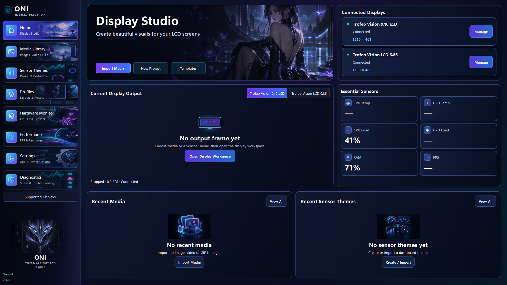
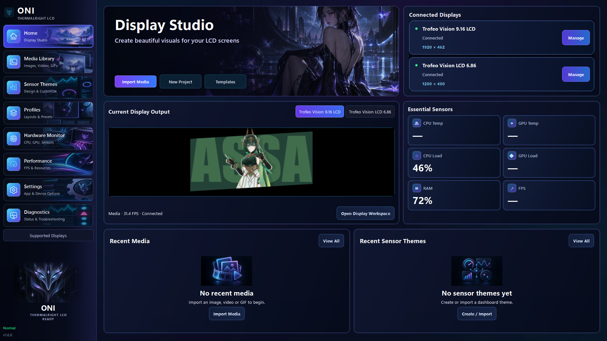
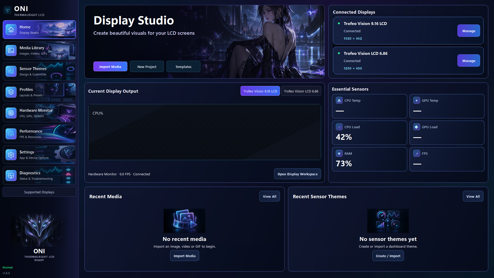

# ONI Thermal LCD Control

> A lightweight Windows controller for Thermalright and compatible USB LCD displays.

[](https://github.com/OniSamaZD/Oni-Thermal-LCD-Control/releases/latest)
[](#installation)
[](https://www.python.org/)
[](LICENSE)

ONI provides a responsive desktop workspace for controlling multiple USB LCDs, playing media, composing live sensor dashboards, and restoring per-display output after restart. Version 0.1.1 uses native Windows device and process discovery in normal GUI operation—no PowerShell, CIM, or WMI subprocess is required.

ONI is an independent project and is not an official Thermalright application. Thermalright and other product names are trademarks of their respective owners.

## Screenshots

### Dual display control · Verified hardware



<details>
<summary>More screenshots</summary>

### Photo · Video · GIF



### Sensor themes · Hardware monitoring



</details>

## Features

- 🖥 **Display Studio** — per-display management, multi-display output, Side-by-Side and Stacked workspaces, and responsive layouts.
- 🖼 **Media output** — images, video and animated GIFs with Fit, Fill, Center, position, zoom and rotation controls.
- 📊 **Sensor themes** — visual hardware-monitor layouts and Sensor + Media composition where supported.
- ☀ **Display controls** — brightness and output settings are maintained independently per display.
- ⚡ **Native discovery** — native Windows metadata, HID, WinUSB and SCSI discovery with stable physical-device/session identity and fast rescans.
- 🔄 **Restore** — safe persisted output configurations can resume after application restart.
- 🛡 **Conflict detection** — detects known conflicting Thermalright utilities through native Windows process enumeration without launching PowerShell.
- 📦 **Distribution** — both an installer and a portable ZIP are available.

## Verified hardware

These paths have been tested against real development hardware:

| Display | VID:PID | Render geometry | Transport |
| --- | --- | ---: | --- |
| Thermalright Trofeo Vision 9.16 LCD | `0416:5408` | `1920 × 462` | WinUSB |
| Thermalright Trofeo Vision 6.86 LCD | `0416:5302` | `1280 × 480` | HID |

### Experimental/community hardware

Additional devices shown in the Supported Displays catalog are **Experimental** unless explicitly marked Verified. Their implementations are based on available protocol references and automated tests but may still require community hardware validation. Unknown or ambiguous devices remain fail-closed.

## Installation

### Installer

1. Open the [latest GitHub Release](https://github.com/OniSamaZD/Oni-Thermal-LCD-Control/releases/latest).
2. Download `Oni-Thermal-LCD-Control-Setup.exe`.
3. Run the installer and launch **Oni Thermal LCD Control**.

The current Windows binaries are unsigned, so Windows SmartScreen may display a warning. Verify SHA-256 values against the release's `SHA256SUMS.txt` before running a download.

### Portable

1. Download `Oni-Thermal-LCD-Control-0.1.1-Windows-x64-portable.zip` from the latest release.
2. Extract the **entire** archive to a writable folder.
3. Run `Oni Thermal LCD Control.exe` from the extracted folder.

Do not run the executable directly from inside the ZIP.

## Supported media

ONI accepts common image, video and animated GIF formats supported by the bundled Pillow/PyAV runtime. Each display has independent media selection, playback, transform and output-mode controls.

## Sensor themes and hardware monitoring

Sensor themes support positioned text, values, images, bars, gauges, graphs, clocks and other visual elements. Themes can use live sensor bindings, configurable styling and bounded graph history. See [Sensor Themes](docs/sensor-themes.md) and the [layout schema](docs/oni-sensor-layout-schema.md).

## Multi-display support

Connected hardware is discovered dynamically; the support catalog never creates fake Connected Displays. Each physical display receives its own session, output mode, media/theme state and render geometry.

## Performance and architecture

- Asynchronous startup keeps the shell responsive while devices are discovered.
- Native discovery measured around 100 ms during source validation on the development machine; results are hardware- and system-dependent.
- Latest-frame queues are bounded to avoid playback catch-up backlogs.
- Static-frame caching avoids unnecessary encode/send work.
- Normal production playback uses software PyAV decoding; experimental hardware decode is not enabled by default.

Architecture and performance notes are available under [`docs/`](docs/).

## Troubleshooting

- Extract portable builds completely before launch.
- Close Thermalright tools such as TRCC/USBLCD if ONI reports a conflict.
- Confirm that the display uses its expected Windows driver/transport.
- Use **Diagnostics** and include the display model, VID:PID, Windows version and reproduction steps in bug reports.
- Do not copy another machine's legacy `device-allowlist.json` or disable device-safety checks.

Reviewed `0416:5408` and `0416:5302` devices use the built-in public onboarding path; no private allowlist or manual JSON editing is required.

## Development status

Version 0.1.1 is the current public release. Development validation completed with:

- 500/500 discovery stress transactions
- 100/100 real-GUI rescans
- 20 lifecycle cycles
- 380/380 unittest tests
- 457 pytest tests + 22 subtests
- 24/24 UI-lock protected regions
- 5/5 portable and 5/5 installed restart checks

These are development-system measurements and do not guarantee identical results on every PC or experimental device.

## Development

Python 3.12 is the validated source environment.

```powershell
py -3.12 -m pip install -r requirements.txt
$env:PYTHONPATH = "src"
py -3.12 -m thermalright_lcd.gui
```

Run the regression suites:

```powershell
$env:PYTHONPATH = "src"
py -3.12 -m unittest discover -s tests -q
py -3.12 -m pytest -q
py -3.12 tools\ui_lock.py check
```

See [CONTRIBUTING.md](CONTRIBUTING.md), [packaging notes](docs/packaging.md), and [device safety](docs/safety.md) before changing device support.

## Roadmap

- Physical-size-aware LCD previews
- Connected-device status in the Supported Displays catalog
- Richer UI interactions and effects
- Selectable application themes
- Broader community-display validation
- Further hardware-monitor and sensor-theme improvements

## Credits

ONI Thermal LCD Control is developed and tested as an independent project.

Built with **ChatGPT + Codex**.

Hardware protocol validation and testing are performed against real development hardware where explicitly marked as Verified. Open-source protocol references and third-party components retain their respective licenses and credits; see [THIRD_PARTY_NOTICES.md](THIRD_PARTY_NOTICES.md).

## License

Released under the [MIT License](LICENSE).
